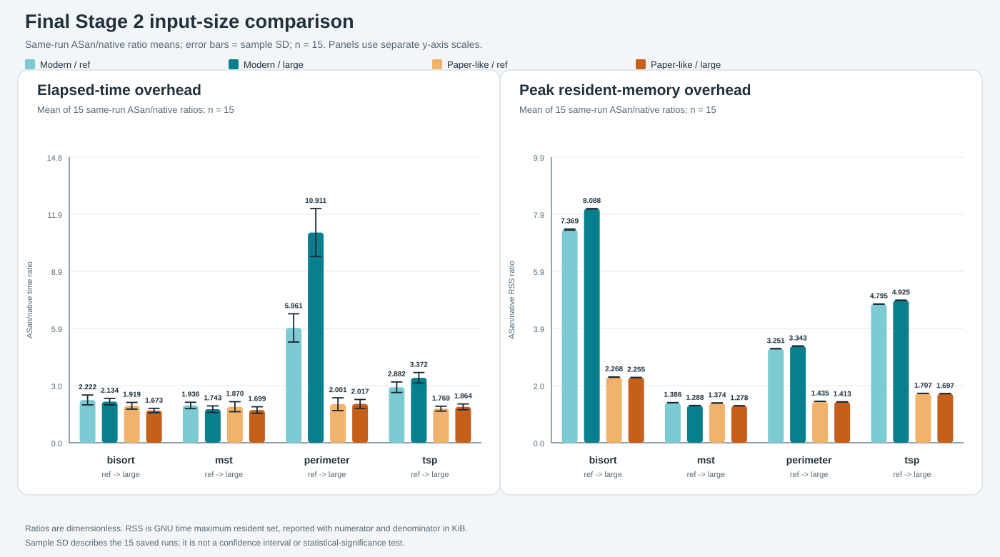

# Final Stage 2 Analysis: Paired Overhead and Input Size

## Scope and data

This report is a new Direction B interpretation of the accepted Stage 2
record. It does not replace or modify the earlier Stage 2 or Week 3 reports.

Let **M** denote:

`records/stage2/20261105T142515Z-caf43a/measurements.json`

Only records with `phase == "performance"` are used. For every workload,
configuration, and run, the ASan elapsed time is divided by the native
elapsed time from the same workload and run. The 15 per-run ratios are then
summarized with `statistics.mean` and `statistics.stdev`; the latter uses the
sample-SD denominator `n - 1`. The same procedure is applied to
`max_rss_kib`. Mean ratios are never calculated as mean ASan time divided by
mean native time.

All calculations retain the source JSON's floating-point values. Values in
this report are displayed to three decimal places only after aggregation.
The selected configuration is always the exact source key
`asan-modern` (called “modern”) or `asan-paper-like` (called
“paper-like”).

Unless a table says otherwise, a trial locator in this report means:

`phase=performance; workload=<workload>; configuration=<native and selected ASan profile>; run=1-15`

Each selected group contains 15 native records and 15 ASan records, with no
missing or duplicate run identifiers.

## Application-type results

The accepted Stage 2 matrix contains 12 workloads. Four are selected below
to explain application diversity and the largest observed timing overhead.
These four workloads are an explanatory subset. They do **not** represent
all 12 workloads and are not used as an aggregate or as a SPEC proxy.

| Workload | Type and reason for selection | Native time, mean +/- sample SD (s) | Modern paired-ratio mean +/- sample SD | Paper-like paired-ratio mean +/- sample SD | Source locator |
|---|---|---:|---:|---:|---|
| `bullet-ref` | C++ physics application; adds a compute-oriented application type | 2.033 +/- 0.053 | 2.041 +/- 0.066 | 2.023 +/- 0.086 | M; `workload=bullet-ref`; native plus both ASan profiles; runs 1-15 |
| `pairlocalalign-ref` | MAFFT sequence-processing application; adds a different application and output profile | 9.394 +/- 0.167 | 1.508 +/- 0.023 | 1.489 +/- 0.027 | M; `workload=pairlocalalign-ref`; native plus both ASan profiles; runs 1-15 |
| `security-sha-ref` | Integer-hashing application with a short native workload; exposes the short-measurement boundary | 0.011 +/- 0.001 | 1.670 +/- 0.141 | 1.647 +/- 0.161 | M; `workload=security-sha-ref`; native plus both ASan profiles; runs 1-15 |
| `treeadd-ref` | Olden workload with the largest observed modern timing ratio in the 12-workload Stage 2 result table | 0.112 +/- 0.021 | 25.818 +/- 2.773 | 4.041 +/- 0.410 | M; `workload=treeadd-ref`; native plus both ASan profiles; runs 1-15 |

Table note: every ratio cell is the mean and sample SD of 15 same-run
ASan/native ratios (`n = 15`) selected from M. Native time is the mean and
sample SD of the corresponding 15 native records (`n = 15`). The rounded
values agree with `reports/stage2/results.md`; the calculations in this
report use the unrounded observations in M.

## Reference versus large inputs

The following table compares the four workloads that have both reference
and large inputs. For each input and ASan profile, time and RSS ratios are
calculated independently within each run. The descriptive difference is
`large-input mean ratio - reference-input mean ratio`.

| Workload | ASan profile | Reference time ratio, mean +/- sample SD | Large-input time ratio, mean +/- sample SD | Time descriptive difference | Reference RSS ratio, mean +/- sample SD | Large-input RSS ratio, mean +/- sample SD | RSS descriptive difference | Source locator |
|---|---|---:|---:|---:|---:|---:|---:|---|
| bisort | modern | 2.222 +/- 0.256 | 2.134 +/- 0.170 | -0.089 | 7.369 +/- 0.020 | 8.088 +/- 0.006 | +0.719 | M; `bisort-ref` and `bisort-large`; native plus `asan-modern`; runs 1-15 |
| bisort | paper-like | 1.919 +/- 0.175 | 1.673 +/- 0.113 | -0.246 | 2.268 +/- 0.007 | 2.255 +/- 0.002 | -0.013 | M; `bisort-ref` and `bisort-large`; native plus `asan-paper-like`; runs 1-15 |
| mst | modern | 1.936 +/- 0.166 | 1.743 +/- 0.171 | -0.193 | 1.386 +/- 0.003 | 1.288 +/- 0.000 | -0.098 | M; `mst-ref` and `mst-large`; native plus `asan-modern`; runs 1-15 |
| mst | paper-like | 1.870 +/- 0.260 | 1.699 +/- 0.170 | -0.171 | 1.374 +/- 0.002 | 1.278 +/- 0.000 | -0.096 | M; `mst-ref` and `mst-large`; native plus `asan-paper-like`; runs 1-15 |
| perimeter | modern | 5.961 +/- 0.733 | 10.911 +/- 1.244 | +4.950 | 3.251 +/- 0.000 | 3.343 +/- 0.000 | +0.093 | M; `perimeter-ref` and `perimeter-large`; native plus `asan-modern`; runs 1-15 |
| perimeter | paper-like | 2.001 +/- 0.331 | 2.017 +/- 0.229 | +0.016 | 1.435 +/- 0.000 | 1.413 +/- 0.000 | -0.021 | M; `perimeter-ref` and `perimeter-large`; native plus `asan-paper-like`; runs 1-15 |
| tsp | modern | 2.882 +/- 0.273 | 3.372 +/- 0.274 | +0.490 | 4.795 +/- 0.003 | 4.925 +/- 0.001 | +0.131 | M; `tsp-ref` and `tsp-large`; native plus `asan-modern`; runs 1-15 |
| tsp | paper-like | 1.769 +/- 0.127 | 1.864 +/- 0.150 | +0.094 | 1.707 +/- 0.001 | 1.697 +/- 0.000 | -0.010 | M; `tsp-ref` and `tsp-large`; native plus `asan-paper-like`; runs 1-15 |

Table notes:

- Every mean and sample SD is calculated from 15 paired ratios
  (`n = 15`) for its named workload, input, and ASan profile.
- Differences use the unrounded large-input and reference-input means, then
  are displayed to three decimals. Because they compare two different
  inputs, these are descriptive differences of group means, not paired
  intervention estimates.
- Time is measured in seconds. RSS is measured in KiB.
- RSS is the GNU time maximum resident-set size, **not VmPeak**.
- The values agree at three decimals with the output of
  `reports/week-20261109/compute_final_ratios.py`, which reads only M.

## Figure

**Figure 1.** Reference-versus-large-input comparison for `bisort`, `mst`,
`perimeter`, and `tsp`. The left panel shows paired elapsed-time ratios;
the right panel shows paired peak-RSS ratios. Light and dark bars denote
reference and large inputs, while teal and orange denote the modern and
paper-like ASan configurations, respectively. Each bar is the mean of 15
same-run ASan/native ratios, and each error bar is the sample SD (`n = 15`).
RSS uses GNU time maximum resident-set values in KiB. The separate panel
scales improve visibility but should be considered when comparing the
absolute heights of the two metrics.

## Observations

The selected application workloads show different observed timing ratios:
Bullet is `2.041 +/- 0.066`, MAFFT is `1.508 +/- 0.023`, and SHA is
`1.670 +/- 0.141` under modern ASan (M; same-run paired-ratio mean and
sample SD; `n = 15`). Treeadd has the largest observed modern ratio among
the 12 Stage 2 workloads, `25.818 +/- 2.773` (M; same-run paired-ratio
mean and sample SD; `n = 15`).

For the four workloads with both inputs, the modern timing-ratio mean
decreases from reference to large input for bisort and mst, and increases
for perimeter and tsp:

- bisort: `2.222` to `2.134` (M; paired-ratio mean; `n = 15` each).
- mst: `1.936` to `1.743` (M; paired-ratio mean; `n = 15` each).
- perimeter: `5.961` to `10.911` (M; paired-ratio mean; `n = 15` each).
- tsp: `2.882` to `3.372` (M; paired-ratio mean; `n = 15` each).

This is only the observed direction in these four ref/large comparisons.
It does not establish that larger inputs generally reduce or increase
overhead ratios.

The sample SDs describe within-group dispersion over the 15 saved runs.
They are not confidence intervals, standard errors, or evidence of
statistical significance.

## Interpretation

Interpretation is restricted to the following evidence-supported points.

1. **Short-workload duration is a measurement limitation.** The timing
   boundary includes process launch and exit, and output capture occurs
   within the timed execution path. For short workloads, fixed startup and
   output handling can be a material fraction of the measured elapsed time.
   The saved data do not provide a decomposition separating those costs
   from workload computation. Any quantitative attribution to startup or
   output cost is therefore **insufficient evidence**.
2. **Modern and paper-like results cannot be attributed to one parameter.**
   The two runtime profiles change multiple ASan settings together.
   Comparing their paired ratios can show that the configured profiles
   differ, but it cannot identify which individual setting caused a
   difference.
3. **Cross-stage differences cannot be attributed only to repetition
   count.** Stage 1 and Stage 2 used different launch wrappers and output
   capture methods. The change from five to 15 repetitions is not the only
   between-stage difference, so a numerical difference across stages is
   **insufficient evidence** for an effect of repetition count alone.

No allocation counters, instruction counts, or hardware performance
counters are used in this report. Mechanistic explanations for the
Bullet-versus-MAFFT-versus-SHA differences or for the four input-size
directions are therefore **insufficient evidence**.

## Limitations

- **Measurement boundary.** The timer includes shell/taskset/GNU time,
  process launch, and exit. Short workloads are especially sensitive to
  fixed costs. Complete output capture is also performed within the timed
  execution path, with compression and copying after timing.
- **Limited replication.** Each group contains 15 repeated runs from one
  accepted Stage 2 record and environment. This is not a multi-machine
  independent replication.
- **Substitute workloads.** These are selected open-source workloads, not
  SPEC CPU2006. The values must not be combined into a SPEC-style score or
  interpreted as an exact reproduction of the paper's reported overhead.
- **RSS is not VmPeak.** The recorded `max_rss_kib` is GNU time peak
  resident memory. It is not virtual-address-space peak and cannot be
  substituted directly for a VmPeak result.
- **No significance inference.** Sample SD describes dispersion among the
  15 runs. It is not a confidence interval or a significance test, and no
  significance claim is made.
- **No reproduction-error aggregate.** No mean is formed across these
  workloads to compare with a published SPEC aggregate. Different
  workloads, environments, and metrics do not justify such a subtraction.

## Self-check

The four selected application statistics and the eight ref/large
time-and-RSS rows were checked against the unrounded calculations from M
and against the three-decimal values in
`reports/week-20261109/compute_final_ratios.py`. All displayed values match;
descriptive differences were computed before rounding. No original
measurement or earlier report was modified.
