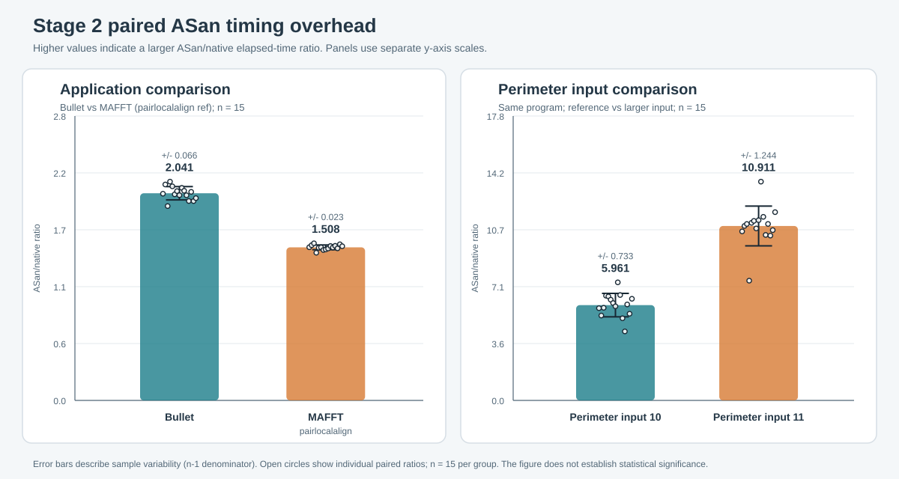

# Stage 2 Independent Paired-Ratio Analysis

Analysis date: 2026-11-07

## Scope and method

This analysis uses the accepted Stage 2 record at
`records/stage2/20261105T142515Z-caf43a/`. The repository state inspected
for the analysis was branch `week3/zhang-yuexiang-analysis` at commit
`98cf5f0249dd0537e02b4527c25c1e963c099eeb`. The commit identifier was read
from the local repository metadata; no Git command was executed.

The selected configuration is `asan-modern`, and the denominator is the
same-round `native` measurement. Only records with
`phase == "performance"` are eligible. Pilot and warm-up records are
excluded before run matching.

For each workload \(w\) and run \(i\), the calculation is

\[
r_{w,i}=\frac{t^{\mathrm{ASan}}_{w,i}}{t^{\mathrm{native}}_{w,i}},
\]

\[
\bar r_w=\frac{1}{n}\sum_{i=1}^{n}r_{w,i},
\qquad
s_w=\sqrt{\frac{\sum_{i=1}^{n}(r_{w,i}-\bar r_w)^2}{n-1}}.
\]

The mean of all native times and the mean of all ASan times are reported
separately; they are not used to form the overhead ratio. All statistical
calculations use the unrounded values from `measurements.json`. Tables and
the figure display three decimal places where requested.

Sources:

- `records/stage2/20261105T142515Z-caf43a/measurements.json`:
  `phase`, `workload`, `configuration`, `run`, and `elapsed_seconds`.
- `records/stage2/20261105T142515Z-caf43a/summary.json`:
  `paired_time_ratio.mean`, `paired_time_ratio.sd`, and
  `paired_time_ratio.n`.
- `records/stage2/20261105T142515Z-caf43a/workloads.json`:
  workload command templates and input arguments.
- `records/stage2/20261105T142515Z-caf43a/protocol.json`:
  timing scope, capture method, RSS definition, and experiment limits.

## Run integrity and pairing basis

Each selected workload/configuration combination contains exactly 15
performance records. The run identifiers are exactly 1 through 15, with no
missing or duplicate runs.

| Workload | Input | Native count | ASan modern count | Paired runs | Missing runs | Duplicate runs |
|---|---|---:|---:|---|---|---|
| bullet-ref | Bullet workload, no command-line argument | 15 | 15 | 1-15 | None | None |
| pairlocalalign-ref | MAFFT `pairlocalalign` with the recorded command line | 15 | 15 | 1-15 | None | None |
| perimeter-ref | `perimeter 10` | 15 | 15 | 1-15 | None | None |
| perimeter-large | `perimeter 11` | 15 | 15 | 1-15 | None | None |

The MAFFT group in the comparison is the `pairlocalalign-ref` workload
located under `MultiSource/Benchmarks/mafft`. The two perimeter inputs are
kept separate. No ratio is formed between `perimeter-ref` and
`perimeter-large`; each input is paired independently with its own native
runs.

## Key statistics and summary-file check

| Workload | Native mean (s) | ASan modern mean (s) | Paired-ratio mean | Sample SD | n | Summary mean | Summary SD | Mean difference | SD difference |
|---|---:|---:|---:|---:|---:|---:|---:|---:|---:|
| bullet-ref | 2.033 | 4.147 | 2.041 | 0.066 | 15 | 2.041 | 0.066 | 0.000000 | 0.000000 |
| pairlocalalign-ref | 9.394 | 14.164 | 1.508 | 0.023 | 15 | 1.508 | 0.023 | 0.000000 | 0.000000 |
| perimeter-ref | 0.102 | 0.602 | 5.961 | 0.733 | 15 | 5.961 | 0.733 | 0.000000 | 0.000000 |
| perimeter-large | 0.387 | 4.161 | 10.911 | 1.244 | 15 | 10.911 | 1.244 | 0.000000 | 0.000000 |

The displayed differences are computed as the independently reconstructed
value minus the corresponding `summary.json` value. At full floating-point
precision all eight paired-ratio mean/SD differences are exactly
`0.000000000000000e+00`. The independently reconstructed native-time and
ASan-time means also match the corresponding `elapsed_seconds.mean`
summary fields exactly.

No inconsistency was found in the four selected groups. The `n` fields,
run filtering, workload keys, configuration keys, and sample-standard-
deviation convention all agree. Consequently, no discrepancy needs to be
attributed to filtering, pairing, field naming, or rounding.

## Complete per-run pairing

| Workload | Run | Native (s) | ASan modern (s) | Ratio |
|---|---:|---:|---:|---:|
| bullet-ref | 1 | 1.978 | 4.029 | 2.036 |
| bullet-ref | 2 | 1.944 | 4.136 | 2.127 |
| bullet-ref | 3 | 2.155 | 4.125 | 1.915 |
| bullet-ref | 4 | 2.001 | 4.312 | 2.155 |
| bullet-ref | 5 | 2.012 | 4.243 | 2.109 |
| bullet-ref | 6 | 2.036 | 4.134 | 2.030 |
| bullet-ref | 7 | 2.043 | 4.212 | 2.062 |
| bullet-ref | 8 | 2.014 | 4.072 | 2.022 |
| bullet-ref | 9 | 1.994 | 4.176 | 2.094 |
| bullet-ref | 10 | 2.006 | 4.142 | 2.066 |
| bullet-ref | 11 | 2.043 | 4.129 | 2.021 |
| bullet-ref | 12 | 2.082 | 4.090 | 1.965 |
| bullet-ref | 13 | 2.007 | 4.124 | 2.055 |
| bullet-ref | 14 | 2.088 | 4.100 | 1.964 |
| bullet-ref | 15 | 2.094 | 4.174 | 1.993 |
| pairlocalalign-ref | 1 | 9.197 | 13.878 | 1.509 |
| pairlocalalign-ref | 2 | 9.206 | 14.077 | 1.529 |
| pairlocalalign-ref | 3 | 9.206 | 14.249 | 1.548 |
| pairlocalalign-ref | 4 | 9.790 | 14.244 | 1.455 |
| pairlocalalign-ref | 5 | 9.413 | 14.153 | 1.504 |
| pairlocalalign-ref | 6 | 9.347 | 14.094 | 1.508 |
| pairlocalalign-ref | 7 | 9.506 | 14.086 | 1.482 |
| pairlocalalign-ref | 8 | 9.459 | 14.068 | 1.487 |
| pairlocalalign-ref | 9 | 9.620 | 14.396 | 1.496 |
| pairlocalalign-ref | 10 | 9.339 | 14.206 | 1.521 |
| pairlocalalign-ref | 11 | 9.328 | 14.047 | 1.506 |
| pairlocalalign-ref | 12 | 9.346 | 14.235 | 1.523 |
| pairlocalalign-ref | 13 | 9.547 | 14.303 | 1.498 |
| pairlocalalign-ref | 14 | 9.327 | 14.346 | 1.538 |
| pairlocalalign-ref | 15 | 9.270 | 14.083 | 1.519 |
| perimeter-ref | 1 | 0.098 | 0.564 | 5.770 |
| perimeter-ref | 2 | 0.109 | 0.580 | 5.308 |
| perimeter-ref | 3 | 0.096 | 0.554 | 5.794 |
| perimeter-ref | 4 | 0.096 | 0.629 | 6.550 |
| perimeter-ref | 5 | 0.096 | 0.626 | 6.504 |
| perimeter-ref | 6 | 0.093 | 0.587 | 6.300 |
| perimeter-ref | 7 | 0.094 | 0.576 | 6.091 |
| perimeter-ref | 8 | 0.095 | 0.558 | 5.886 |
| perimeter-ref | 9 | 0.101 | 0.748 | 7.385 |
| perimeter-ref | 10 | 0.093 | 0.616 | 6.594 |
| perimeter-ref | 11 | 0.125 | 0.642 | 5.140 |
| perimeter-ref | 12 | 0.149 | 0.642 | 4.316 |
| perimeter-ref | 13 | 0.097 | 0.582 | 6.003 |
| perimeter-ref | 14 | 0.102 | 0.551 | 5.422 |
| perimeter-ref | 15 | 0.090 | 0.575 | 6.357 |
| perimeter-large | 1 | 0.384 | 4.063 | 10.571 |
| perimeter-large | 2 | 0.364 | 3.969 | 10.913 |
| perimeter-large | 3 | 0.361 | 3.985 | 11.036 |
| perimeter-large | 4 | 0.598 | 4.477 | 7.491 |
| perimeter-large | 5 | 0.382 | 4.238 | 11.108 |
| perimeter-large | 6 | 0.361 | 4.058 | 11.229 |
| perimeter-large | 7 | 0.373 | 4.009 | 10.757 |
| perimeter-large | 8 | 0.359 | 4.042 | 11.273 |
| perimeter-large | 9 | 0.354 | 4.842 | 13.685 |
| perimeter-large | 10 | 0.364 | 4.184 | 11.483 |
| perimeter-large | 11 | 0.404 | 4.185 | 10.351 |
| perimeter-large | 12 | 0.376 | 4.151 | 11.038 |
| perimeter-large | 13 | 0.388 | 4.004 | 10.309 |
| perimeter-large | 14 | 0.368 | 3.924 | 10.652 |
| perimeter-large | 15 | 0.364 | 4.283 | 11.776 |

## Figure



The left panel compares Bullet with MAFFT `pairlocalalign`. The right panel
compares Perimeter input 10 with input 11. Bars show the mean of the 15
same-run ASan/native ratios; error bars show sample SD. Open circles show
the individual paired ratios. Each panel uses its own y-axis scale to keep
both comparisons readable. The figure does not include a significance test
or confidence interval.

## Observations

1. **Bullet versus MAFFT.** The observed Bullet paired-ratio mean is
   `2.041 +/- 0.066`, while MAFFT `pairlocalalign` is
   `1.508 +/- 0.023` (sample SD; n = 15). The observed mean ratio is
   `0.533` higher for Bullet in this record.
2. **Perimeter input 10 versus input 11.** The observed ratio mean is
   `5.961 +/- 0.733` at input 10 and `10.911 +/- 1.244` at input 11
   (sample SD; n = 15). The larger input has an observed mean ratio
   `4.950` higher, not lower.
3. **Variation.** The figure displays the individual paired ratios alongside
   group means and sample SDs so that the within-group variation remains
   visible. This descriptive display is not a substitute for a formal
   hypothesis test, and no statistical-significance claim is made.
4. **Answer to whether a larger input necessarily lowers the ratio.**
   It does not necessarily do so in this record. Perimeter input 11 has a
   higher observed ratio than input 10. This result alone cannot establish
   a general monotonic or non-monotonic relation between input size and
   ASan overhead.

## Limitations

- **Short-workload launch cost.** Perimeter input 10 has a native mean of
  `0.102` seconds. The protocol timer includes process launch, shell setup,
  and exit, so fixed startup cost can be a substantial fraction of a short
  trial. The available data do not decompose that fixed cost from
  workload execution.
- **Different capture methods across batches.** Stage 1 and Stage 2 used
  different launch wrappers and output-capture arrangements. This report
  uses only within-Stage-2 pairs, so no cross-batch numeric comparison is
  made. The Stage 2 protocol records that full stdout/stderr were captured
  during the timed interval, with compression after timing.
- **Incomplete equivalence across applications.** Bullet and MAFFT differ
  in algorithm, input format, execution duration, and output volume.
  Normalizing each run by its native time removes the native-time scale,
  but it does not make the applications otherwise equivalent.
- **RSS is not VmPeak.** The recorded memory field is GNU time peak resident
  set (`max_rss_kib`), not VmPeak. RSS is not used in this timing analysis.
- **Descriptive sample size and environment.** There are 15 repeated runs
  within a single accepted Stage 2 record and environment. Repeated runs do
  not constitute an external multi-machine replication.
- **No significance inference.** Error bars are sample standard deviations,
  not confidence intervals, standard errors, or hypothesis-test results.
  The figure and the means do not establish statistical significance.

## Unverified explanations

Potential explanations such as workload-specific startup cost, memory
access behavior, allocation behavior, input-dependent instrumentation, or
output handling are **unverified** in this analysis. The available files do
not contain a controlled decomposition that isolates those effects. This
analysis therefore does not attribute the Bullet-versus-MAFFT difference
or the Perimeter input-size difference to a specific cause.

No claim is made that the selected ASan configuration reproduces the
complete results of the original paper, and no SPEC-style aggregate score
is computed.

## Reproduction

From the repository root:

```text
python reports/week3/compute_stage2_ratios.py
```

The script uses only the Python standard library, reads the two raw JSON
files, prints all four integrity checks, the complete 60-row pairing table,
the four summary statistics, the exact summary differences, and the
descriptive comparison deltas. It regenerates
`reports/week3/figures/stage2-analysis.svg` from the same computed results.
